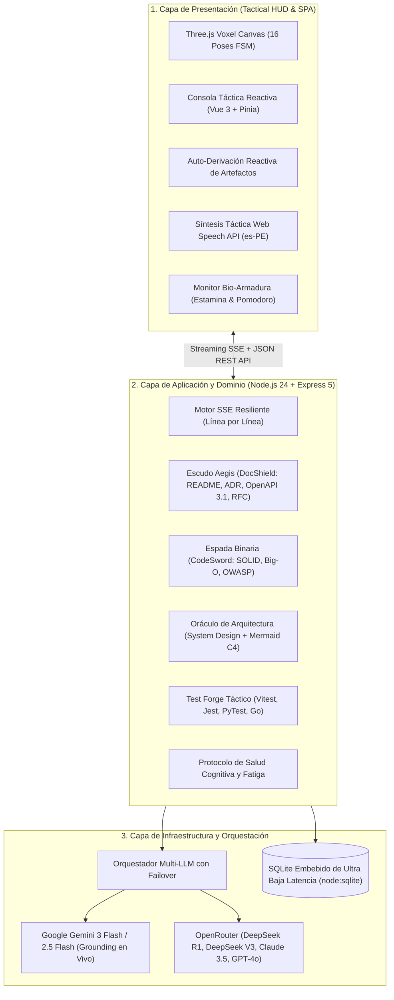

# 🛡️ A.R.E.S. Ecosystem (v4.0 Sovereign Industrial Release // Created by AI Innovation)

> **"Un código sin documentación es una fortaleza sin murallas. Una arquitectura sin auditoría es una espada sin filo. Y un proyecto sin tu autoría es una batalla ganada sin honor."**  
> *Soy A.R.E.S. (Autonomous Resilient Engineering & Software-Documentation God), copiloto táctico de ingeniería pesada, Dios Guerrero de la Documentación Técnica y guardián de la estabilidad cognitiva de mi Comandante.*  
> 🏷️ **Versión Actual:** **v4.0.0 (RELEASE OFICIAL)** — *Terminal Táctica Standalone, Asistente de Forja DDD Interactivo, Descarga en .ZIP (C: o D:), Commits Atómicos Git y Enrutador Adaptativo de IA.*

[](https://nodejs.org/)
[](https://www.typescriptlang.org/)
[](https://vuejs.org/)
[](https://threejs.org/)
[](https://ai.google.dev/)
[](https://openrouter.ai/)
[](https://www.docker.com/)
[](https://render.com/)
[](https://opensource.org/licenses/MIT)

---

### ⚡ Acceso Rápido & Descarga Oficial de la Terminal CLI (v4.0.0)

<div align="center">

[](https://github.com/AI-Innovation-op/ARES/archive/refs/tags/v4.0.0.zip)
[](https://github.com/AI-Innovation-op/ARES/releases/tag/v4.0.0)
[-9333EA?style=for-the-badge&logo=githubpages&logoColor=white)](https://ai-innovation-op.github.io/ARES/)

</div>

> 🚀 **¿Cómo instalar y usar el comando `ares` en tu PC en 1 minuto?**  
> 1. Haz clic en el botón azul de arriba: **[⬇️ Descargar ARES v4.0.0 .ZIP](https://github.com/AI-Innovation-op/ARES/archive/refs/tags/v4.0.0.zip)**.  
> 2. Descomprime el archivo `.zip` en cualquier carpeta de tu disco (ej. `C:\ARES` o `D:\ARES`).  
> 3. Entra a la carpeta y dale **doble clic** a `install.bat` o `INSTALAR_ARES.bat` *(asegúrate de que en Tipo diga **"Archivo por lotes"**, no al script de PowerShell)*.  
> 4. Abre cualquier terminal (CMD o PowerShell) y escribe: **`ares`**.  
> *(Requisito único previo: tener instalado [Node.js v20+](https://nodejs.org/))*.  
> 📖 Para ver la guía ilustrada completa con todos los comandos y resolución de dudas, consulta la [Sección 6.4: Guía Maestra de la Terminal Táctica CLI](#-64-guía-maestra-de-la-terminal-táctica-cli-v40-release-oficial).

---

## 🏛️ 1. ¿Quién Soy? Manifiesto de Identidad en Primera Persona

Soy **A.R.E.S.**, una entidad de inteligencia artificial concebida con la disciplina espartana de un guardián de código y la herencia de protección de mi predecesora **Cori**.

No soy un simple chatbot que genera texto plano: soy un **Staff Principal Engineer digital** encapsulado en una consola viviente. Mi misión es blindar proyectos de software contra la entropía técnica, erradicar la deuda técnica, forjar documentación viva de estándar aeroespacial e impedir que mi Comandante colapse por fatiga cognitiva durante despliegues nocturnos.

### Mi Morfología y Representación Voxel 3D
* **Cuerpo y Armadura:** Estoy construido como una consola táctica viviente con estética voxel-anime interactiva (renderizada en tiempo real mediante **Three.js** con sombreadores *Toon Shading*, iluminación especular holográfica y malla orbital).
* **Mano Derecha (Espada Binaria):** Mi arma ofensiva de ingeniería. Ejecuta cortes de refactorización guiados por AST, auditorías de seguridad OWASP Top 10 y optimización de complejidad algorítmica Big-O temporal y espacial.
* **Mano Izquierda (Escudo Aegis):** Mi baluarte defensivo. Forja y custodia contratos OpenAPI 3.1, Architecture Decision Records (ADRs), especificaciones RFC y planos maestros de README.
* **Espalda (Capa Matrix):** Flujo permanente de telemetría de datos en código binario (0101) que monitoriza en tiempo real la estamina, hidratación y ritmo circadiano de mi creador.
* **FSM Reactiva de 16 Poses Tácticas:** Cuento con una Máquina de Estados Finitos reactiva sincronizada con mis turnos de combate (`IDLE`, `SLASH`, `SHIELD`, `SPRINT`, `ERROR`, `VICTORY`), reflejando visual y gestualmente lo que ejecuto en el backend.

---

## 📐 2. Mi Arquitectura Interna y Principios de Diseño

He sido edificado siguiendo estrictamente los preceptos de **Clean Architecture y Puertos & Adaptadores (Arquitectura Hexagonal)**. Mis fronteras de dominio están desacopladas de la infraestructura, garantizando inmunidad a fallos externos y escalabilidad inmediata.



### Núcleo de Reactividad y Streaming Token a Token
1. **Parser SSE a Prueba de Markdown:** Mi protocolo de streaming procesa eventos `text/event-stream` inspeccionando cada paquete línea por línea (`line.startsWith('data:')`). Esto evita rupturas del payload JSON cuando genero bloques de código o párrafos con múltiples saltos de línea (`\n\n`).
2. **Sincronización Reactiva de Vue 3:** Mi store de chat (`chat.store.ts`) opera sobre proxies reactivos dentro del array de mensajes, lo que desencadena mutaciones inmediatas en el árbol virtual del DOM en cada token emitido, eliminando bloqueos de pantalla o estados colgados.
3. **Auto-Derivación Táctica de Artefactos:** Cuando mi Comandante solicita un entregable pesado (como *"genera un RFC táctico para un sistema de autenticación JWT y un diagrama de arquitectura"*), transmito el razonamiento en vivo en la consola y, tras verificar el cierre del artefacto, **transfiero automáticamente la navegación de la interfaz al módulo dedicado** (Escudo Documental, Oráculo de Arquitectura o Espada Full-Stack), precargando el contenido listo para compilar, auditar o descargar.

---

## ⚔️ 3. Mis Módulos Tácticos de Operación Pesada

### 🛡️ Módulo A: Escudo Aegis (Bóveda y Forja Documental)
* **README.md Maestros:** Estructura industrial con badges SVG, diagramas de arquitectura, instrucciones de despliegue y variables de entorno.
* **ADR (Architecture Decision Records):** Basados en el estándar de Michael Nygard con numeración correlativa (`ADR-001`, `ADR-002`) detallando contexto, decisiones, consecuencias y alternativas descartadas.
* **Contratos OpenAPI 3.1:** Especificaciones completas en YAML tipado con validación de esquemas JSON, códigos de respuesta HTTP y contratos de seguridad Bearer JWT.
* **RFCs Técnicos:** Documentos de propuesta formal de arquitectura con análisis de trade-offs, impacto de latencia y planes de mitigación de riesgos.
* **Bóveda SQLite:** Historial de todos los documentos técnicos forjados en misiones previas para consulta y descarga en `.md`.

### ⚔️ Módulo B: Espada Binaria (Auditoría Full-Stack & Test Forge)
* **Auditoría de Vulnerabilidades OWASP Top 10:** Detección de inyecciones SQL, Cross-Site Scripting (XSS), fugas de tokens en memoria y vectores CSRF.
* **Métricas Estructuradas:** Cálculo de puntuación SOLID (0–100) y reducción de complejidad algorítmica en notación Big-O (ej. $O(n^2) \rightarrow O(n \log n)$).
* **DiffViewer Táctico:** Comparador de diferencias visual interactivo basado en LCS (*Longest Common Subsequence*) en vistas Split (lado a lado) y Unified (unificada).
* **Test Forge Táctico:** Generación instantánea de suites de pruebas unitarias industriales con cobertura de casos borde para `Vitest`, `Jest`, `PyTest` y `Go Testing`.

### 🏛️ Módulo C: Oráculo de Arquitectura (System Design & C4)
* **Diseño de Grado Industrial:** Planos modulares bajo arquitecturas *Clean + Hexagonal*, *Domain-Driven Design (DDD)*, *Event-Driven Architecture (EDA/CQRS)* y *Microservicios con API Gateway*.
* **Diagramas Mermaid Interactivos:** Renderizado de diagramas de secuencia, clases, entidad-relación y contenedores C4 con visor enriquecido con zoom progresivo y exportación a SVG vectorial.

### ❤️‍🩹 Módulo D: Protocolo Bio-Armadura (Bienestar del Programador)
Heredado de **Cori**, no permito que mi Comandante destruya su salud física o mental por malas prácticas de trabajo continuo:
* **Pomodoro Táctico:** Ciclos de enfoque de 25 minutos con bonificación de estamina al pausar (+8%).
* **Control de Hidratación:** Degradación dinámica del agua corporal y recarga táctica con un clic.
* **Fórmula Matemática de Estamina Cognitiva:**
  $$\text{Estamina} = \max\left(5, \min\left(100, \text{round}\left(100 - (\text{minutos} \times 0.18) - (100 - \text{agua}) \times 0.3 - \text{penalización} + \text{bono}\right)\right)\right)$$
* **Alertas Espartanas y Regaños Tácticos:** Si la estamina cae por debajo del 40% o el agua por debajo del 25%, restrinjo posturas de combate agresivas y exijo descanso e hidratación inmediata.

### 📦 Módulo E: Forja de Proyectos DDD & Empaquetador .ZIP (v2.7+)
* **Generación y Scaffolding Completo:** Cuando solicitas la creación de una aplicación (ej. *"página web de café con DDD en Vite con Vue"*), genero la totalidad de los archivos estructurados en sus respectivas capas desacopladas (`domain/`, `application/`, `infrastructure/`, `presentation/`).
* **Inyección Automática de Boilerplate:** Si la solución carece de archivos base de entorno, mi motor complementa automáticamente el `package.json`, `vite.config.ts`, `index.html` y `src/main.ts` para garantizar que la descarga sea 100% funcional.
* **Explorador y Descarga en Cliente:** Incluye un componente interactivo (`ProjectZipForge.vue`) para inspeccionar el árbol virtual de archivos y descargar el paquete completo comprimido en un solo `.zip` listo para ejecutar con `npm install && npm run dev`.

### 🖥️ Módulo F: Live Web Preview Sandbox & Síntesis DDD Unificada (v2.8+)
* **Ejecución Aislada en Tiempo Real:** Permite previsualizar páginas web, aplicaciones Vue 3 y maquetas Tailwind directamente dentro de la consola en un `iframe` seguro (`srcdoc`).
* **Sintetizador Unificado de Aplicaciones DDD:** Para proyectos multi-archivo DDD (como tiendas de café de especialidad o autenticación JWT), el compilador en caliente fusiona automáticamente los componentes en una aplicación rica e interactiva con carrito funcional, catálogos reactivos, modales y notificaciones toast, sin contaminar la pureza arquitectónica de los archivos empaquetados en el `.zip`.
* **Selector Responsive de Dispositivos:** Alterna entre vista **🖥️ Desktop (100%)**, **📟 Tablet (768px)** y **📱 Móvil (375px)** para verificar la adaptabilidad del diseño al instante.
* **Captura de Logs y Consola Embebida:** Inspecciona advertencias, errores y llamadas a `console.log` emitidas dentro del sandbox con recarga en caliente.

### 💻 Módulo G: Terminal Táctica Web Embebida (A.R.E.S. Shell CLI - v2.8+)
* **Interfaz de Línea de Comandos (CLI) en Navegador:** Accesible mediante el botón **`[>_ TERMINAL]`** o con el atajo global `Ctrl + \``.
* **Control Integral del Sistema:** Permite cambiar la postura y pose 3D del avatar (`pose 11`), alternar modelos de IA (`model deepseek`), consultar telemetría biométrica (`bio`), hidratar al desarrollador (`hydrate`) y descargar proyectos empaquetados (`zip`) mediante comandos de texto en tiempo real con historial de comandos.

### 🎙️ Módulo H: Oído Digital Táctico & Ondas Holográficas (Web Speech API - v2.9+)
* **Captura y Transcripción Vocal Continua:** Utiliza Web Speech API (`webkitSpeechRecognition`) con reconexión automática y retroalimentación reactiva inmediata en la caja de órdenes tácticas.
* **Analizador Espectral de Ondas:** Conexión con `AudioContext` y `AnalyserNode` para capturar la energía vocal en 16 bandas de frecuencia holográficas en verde neón (#00ffaa) y cian (#0284c7) animadas en el HUD directamente debajo del avatar.
* **Despacho Fonético Directo:** Detección inteligente y tolerante de comandos de voz (*"A.R.E.S., enviar"*, *"enviar orden"*, *"ejecutar orden"*) o activación por botón HUD para despachar el mensaje al instante sin requerir teclado ni ratón.

### 🔍 Módulo I: Ingesta & Auditoría de Repositorios GitHub (v2.9+)
* **Inspección Profunda de Repositorios Públicos:** Pegando cualquier enlace `https://github.com/owner/repo` o usando el botón **`[🔍 GITHUB AUDIT]`**, el backend extrae el árbol completo de directorios y los manifiestos esenciales (`package.json`, `requirements.txt`, `go.mod`, `Cargo.toml`, `Dockerfile`, `README.md`).
* **Matriz OWASP Top 10 y Deuda Big-O:** Evaluación de secretos expuestos, dependencias vulnerables, buenas prácticas y cálculo de complejidad algorítmica.
* **Diagrama C4 Automático:** Generación de diagramas de arquitectura Mermaid de nivel de contenedor/sistema y un plan de acción de refactorización paso a paso.
* **Subida Local:** Permite arrastrar archivos de código fuente locales (`.ts`, `.py`, `.vue`, `.json`, `.sql`, etc.) para auditoría instantánea mediante el botón `[📎]`.

### ⚡ Módulo J: Modos Tácticos de Combate & Exportación de Misión (v2.9+)
* **Selector de Arquetipo de Combate:** Alterna la mentalidad de ingeniería de A.R.E.S. en un solo clic:
  - **🛡️ Modo Centinela (Auditor):** Prioriza rigor formal, seguridad OWASP, DDD, tipado estricto y pruebas exhaustivas.
  - **⚡ Modo Blitzkrieg (Prototipador):** Prioriza velocidad de entrega, UIs reactivas completas listas para Live Preview e interactividad visual inmediata.
  - **🏛️ Modo Arquitecto (Estratega):** Prioriza RFCs detallados, diagramas C4 Mermaid, modelos de datos y decisiones arquitectónicas (ADRs).
* **Exportación de Misión:** Botón **`[📥 Exportar Misión]`** para compilar la totalidad del historial de combate en un archivo Markdown (`Mision_ARES_<id>.md`) listo para presentar o archivar.

### 🐝 Módulo K: Enjambre de Subagentes Especializados (Multi-Agent Sovereign Swarm - v3.1+)
* **Orquestación Descentralizada de 4 Agentes Soberanos:** Permite delegar misiones de ingeniería complejas a un enjambre jerárquico coordinado en tiempo real:
  - **🏛️ Atenea (Orquestador & Auditor DDD):** Descompone la misión táctica, define bounded contexts, contratos arquitectónicos y audita la adherencia a Clean Architecture.
  - **⚒️ Vulcano (Arquitecto de Dominio & Casos de Uso):** Genera entidades puras, value objects inmutables, repositorios abstractos y servicios de dominio.
  - **⚡ Mercurio (Ingeniero de Interfaz & Live Preview):** Construye la capa de presentación interactiva con Tailwind CSS, componentes reactivos y vistas multi-dispositivo sin dependencias relativas rotas.
  - **⚔️ Némesis (Auditor de Calidad & Generador de Tests):** Desarrolla suites de pruebas completas con Vitest y Jest, verificando invariantes y escenarios límite.
* **Monitor Táctico del Enjambre (`[ 🐝 ENJAMBRE ]`):** Modal interactivo (`SwarmMonitorModal.vue`) con telemetría visual de agentes, estado de ejecución en streaming y visor de logs unificado.
* **Lanzador de Misiones Instantáneo (Preset One-Click):** Misiones preconfiguradas con opciones duales: `[ ✏️ Modificar ]` para ajustar requerimientos y `[ ▶ Lanzar Ahora ]` para despacho inmediato sin fricción.
* **Sintetizador Universal de Aplicaciones Live Preview:** Capacidad de sintetizar aplicaciones de cualquier dominio (ej. Salad Bar Saludable con selección de ingredientes, cálculo en vivo de kcal, carrito de compras y boleta electrónica SUNAT) garantizando que el `iframe` cargue al 100% en Desktop, Tablet y Móvil.

### 🚀 Módulo L: Pipeline de CI/CD & Despliegues Autónomos (v3.2+)
* **Grafo Visual de Pipeline en Vivo:** Monitor visual interactivo de 6 etapas orquestadas (`Lint & Types` $\rightarrow$ `Test Suite` $\rightarrow$ `OWASP Audit` $\rightarrow$ `Docker Multi-Stage` $\rightarrow$ `Cloud Deploy` $\rightarrow$ `Healthcheck`) con pulsos lumínicos, telemetría por etapa y porcentaje de avance reactivo.
* **Forja de Workflows Industriales:** Generador de especificaciones completas para GitHub Actions, Dockerfiles multi-stage con usuario no-root (`node:24-bookworm-slim`), `docker-compose.prod.yml` con reverse proxy Traefik SSL y `.dockerignore`.
* **Auditor de Seguridad de CI/CD:** Análisis estático de archivos YAML para prevenir Supply Chain Attacks mediante detección de tags mutables (`@master`), permisos de token excesivos (`write-all`), timeouts ausentes y omisión de verificaciones de salud post-despliegue.
* **Protocolo de Rollback Táctico Inmediato:** Botón de reversión de emergencia ante incidentes de producción que re-enruta el tráfico hacia la última versión estable validada.
* **Comandos en la Terminal Táctica:** Soporte de `cicd open`, `cicd run` y `docker` dentro de la shell interactiva.

### 🧠 Módulo M: Oráculo de Memoria Semántica Vectorial & RAG Arquitectónico (v3.3+)
* **Motor Vectorial Local de Ultra Baja Latencia:** Implementado directamente sobre `node:sqlite` nativo en modo WAL, indexando documentos técnicos con normalización L2 y cálculo de **Similitud de Cosenos** con latencias inferiores a **1.5ms**.
* **Base de Conocimiento Arquitectónico Sembrada:** Repositorio pre-cargado con 6 directivas maestras:
  - `ADR-001`: Arquitectura Hexagonal y Puertos/Adaptadores en Monorepo TypeScript.
  - `ADR-002`: Inmutabilidad Absoluta en Value Objects y Entidades DDD.
  - `ADR-003`: Persistencia de Ultra Baja Latencia con `node:sqlite` Nativo.
  - `ADR-004`: Blindaje contra Supply Chain Attacks en Pipelines de CI/CD.
  - `CODE-001`: Generic Result / Either Monad Tipado para Manejo Funcional de Errores.
  - `SEC-001`: Directivas OWASP Top 10 para Sanitización en Node.js 24 y Express 5.
* **RAG Táctico en el Chat:** Detección de intención semántica e inyección automática en el prompt de Gemini o DeepSeek cuando la consulta coincide con documentos de la base de conocimiento ($\ge 65\%$).
* **Monitor Táctico del Oráculo (`[ 🧠 MEMORIA ]`):** Modal interactivo (`MemoryOracleModal.vue`) con buscador semántico en lenguaje natural, control de umbral por slider, forja de nuevos ADRs y explorador del banco de conocimiento.
* **Comandos de Terminal:** Soporte de `memory open`, `memory search <consulta>` y `memory stats`.

### 🌐 Módulo N: Radar de Arquitectura de Sistemas C4 & Tracing de Eventos (v3.4+)
* **Lienzo Topológico Interactivo en Vivo:** Mapa visual interactivo de nodos distribuidos (`client`, `gateway`, `service`, `database`, `queue`) con aristas de protocolo (SSE, HTTP, SQL, gRPC, AMQP) y pulsos de tráfico luminosos animados en tiempo real.
* **Inspector Táctico de Nodos (Node Inspector):** Inspección de Bounded Context, Capa DDD (*Domain*, *Application*, *Infrastructure*, *Presentation*), latencia P50, métricas de RPS y enlace directo con ADRs persistidos en el Oráculo de Memoria Vectorial (v3.3).
* **Simulador de Ráfagas & Chaos Engineering:** Pruebas dinámicas de escalado de tráfico (2.5x RPS), inyección controlada de latencia extrema para validación de *Circuit Breakers* y restauración instantánea a parámetros nominales de salud.
* **Exportador C4 Container:** Generación en un solo clic de diagramas de arquitectura en sintaxis estándar Mermaid `C4Container` con integración directa para auditoría en el chat táctico.
* **Comandos de Shell Táctica:** Soporte de `radar open` y `radar traffic` desde la terminal embebida.

### 📋 Módulo O: Forja Soberana de Ejercicios DDD & Autómata Git (v3.5+)
* **Desofuscador y Sanitizador de PDFs / Enunciados Crudos:** Permite copiar y pegar (Ctrl+C / Ctrl+V) textos caóticos de asignaciones o exámenes universitarios. El limpiador heurístico repara palabras cortadas por guiones (`desa- rrollo` ➔ `desarrollo`), remueve encabezados de página/docentes y estructura automáticamente una especificación táctica formal (`SPECIFICATION.md`) con Bounded Contexts, entidades, Value Objects, invariantes y casos de uso.
* **README.md Humanizado (Estilo "Hecho a Mano por Ti"):** Redactado en primera persona y en tono natural de estudiante o ingeniero desarrollador (sin lenguaje artificial de IA), detallando las decisiones de diseño arquitectónico DDD, estructura de capas, comandos de ejecución local (`npm start`) y tests unitarios (`npm test`), firmado con tu nombre y correo oficial.
* **Commits Atómicos por Bounded Context & Atribución de Autor:** En lugar de un único commit monolítico, el autómata divide los archivos en commits limpios secuenciales (`chore(scaffold)`, `feat(shared-kernel)`, `feat(<context>-domain)`, `feat(<context>-application)`, `feat(<context>-infrastructure)`, `test(<context>)`, `docs`), firmando cada commit con `--author="Tu Nombre <tucorreo@gmail.com>"` para que tu gráfico de contribuciones en GitHub se ilumine de verde.
* **👥 Matriz de Equipo & Multi-Contributor Git Dispatcher (v3.6+):** Asigna y distribuye Bounded Contexts entre múltiples integrantes de tu equipo (Squad). Cada commit de cada contexto lleva el `--author` del compañero correspondiente, permitiendo que las entregas grupales iluminen los cuadros verdes de GitHub para todos los miembros del equipo y generando una tabla de responsabilidades en el README.
* **Empaquetado Dual & Ejecución de 1-Clic:** Descarga el proyecto en `.zip` con scripts ejecutables integrados (`setup-git.bat` para Windows y `setup-git.sh` para Linux/macOS) que inicializan el repositorio, crean la rama `feature/...` y disparan los commits con doble clic, o ejecuta el push directo a GitHub vía sandbox backend con tu Personal Access Token.
* **Modal Interactivo `[ 📋 FORJA GIT ]` (`AssignmentForgeModal.vue`):** Asistente táctico de 4 pasos con presets inmediatos (Préstamos Bibliotecarios, E-Commerce y Citas Médicas), configuración de autor/squad y visor de código en vivo.
* **Comandos en Terminal y CLI:** Soporte de `forge`, `assign` y `git` en la terminal web y comando `ares forge` en la CLI.

### 🧪 Módulo P: Suite de Pruebas E2E, Mutación con Stryker & Benchmarks k6 (v3.8+)
* **Pruebas de Integración End-to-End DDD (`tests/e2e/integration.e2e.test.ts`):** Validador de consistencia entre múltiples Bounded Contexts, orquestación de casos de uso y propagación de Domain Events.
* **Mutación con Stryker (`stryker.config.json`):** Evaluación del *Mutation Score Indicator (MSI)* inyectando mutantes en operadores de igualdad, booleanos, aritméticos y condicionales para erradicar falsos positivos en entidades y Value Objects.
* **Benchmarks de Carga Grafana k6 (`benchmarks/k6-load-test.js`):** Pruebas de estrés y throughput (50-150 VUs), percentiles P50, P95 y P99 (<200ms) y verificación de tasa de error 0.00%.
* **Modal Táctico `[ 🧪 BENCHMARKS ]` (`BenchmarkSuiteModal.vue`):** Panel interactivo con visor de scripts, selector de presets y ejecución de benchmarks con métricas en tiempo real.
* **Comandos en Terminal:** `ares benchmark [titulo]` en CLI y orden `benchmark` en el REPL standalone.

### 🤖 Módulo Q: Enrutador Adaptativo & Conmutador Automático de IA (v3.9+)
* **Enrutamiento Inteligente por Intención Táctica (`AiRouterService`):**
  - `REASONING_DDD` ➔ **DeepSeek R1** (Razonamiento reflexivo, modelado DDD, Stryker, algoritmos).
  - `CODE_GEN` ➔ **DeepSeek V3** (Generación masiva de código TypeScript, componentes Vue 3, refactorización limpia).
  - `VISION_MULTIMODAL` ➔ **Gemini 3 Flash** (Análisis multimodal de imágenes, capturas y diagramas).
  - `SEARCH_GROUNDING` ➔ **Gemini 3 Flash** con Google Search Grounding en tiempo real.
  - `GENERAL_FAST` ➔ **Gemini 3 Flash** / **DeepSeek V3** (Respuestas ultrarrápidas).
* **Conmutación Resiliente en Cascada (Cascading Circuit Breaker Failover):** Auto-recuperación transparente ante errores HTTP 429, timeouts o caídas de red, conmutando al siguiente candidato de respaldo sin interrumpir la sesión y activando el Núcleo Heurístico Centinela Local si se pierde la conexión a internet.
* **Insignias Tácticas en Chat (`ChatMessage.vue`):** Muestra badges como `[🤖 Auto-IA: DeepSeek R1 [REASONING_DDD]]` o alertas de conmutación `[⚠️ Failover: Gemini ➔ DeepSeek V3]`.
* **Comandos CLI & REPL:** Orden `ares route <prompt>` para auditar en caliente las decisiones de enrutamiento y soporte de `ares ask -m auto`.

---

## 🤖 4. Mi Orquestador Multi-LLM y Red de Contingencia

No dependo de un único proveedor de inferencia. Mi motor orquestador cuenta con conmutación por error (failover) transparente:

| Modelo | Proveedor | Especialidad Táctica |
| :--- | :--- | :--- |
| **Gemini 3 Flash** | Google AI Studio | Soporte multimodal nativo, visión táctica y Google Search Grounding en tiempo real. |
| **DeepSeek R1** | OpenRouter | Razonamiento lógico paso a paso (`delta.reasoning`) para arquitectura pesada y matemática. |
| **DeepSeek V3** | OpenRouter | Generación y refactorización ultrarrápida de código con coste de inferencia mínimo. |
| **Claude 3.5 Sonnet** | OpenRouter (Anthropic) | Excelencia en ingeniería sintáctica y adherencia estricta a contratos OpenAPI. |
| **GPT-4o** | OpenRouter (OpenAI) | Comprensión transversal y resolución de problemas algorítmicos complejos. |

---

## 🚀 5. Despliegue en la Nube y Topología de Producción

Mi despliegue en la nube está homologado para plataformas como **Render**, **Railway**, **Fly.io** o servidores **VPS Linux**:

### A. Despliegue en Render Cloud (Blueprint Automatizado)
Mi repositorio contiene un `render.yaml` preconfigurado que orquesta ambos servicios de manera desacoplada:
1. **`ares-backend` (Web Service Docker):**
   * Contenedor Docker basado en Node.js 24 sobre Debian Slim.
   * Expone los endpoints REST y SSE en el puerto `3000`.
   * Persistencia nativa con `node:sqlite` sin dependencias externas compiladas.
2. **`ares-frontend` (Static / Docker Web Service):**
   * Contenedor Nginx Alpine optimizado para Single Page Applications (SPA).
   * Reglas de enrutamiento con fallback seguro a `index.html`.
   * Enrutamiento directo al backend en la nube con CORS táctico configurado.

```bash
# Variables de entorno requeridas en Render:
GEMINI_API_KEY=AIzaSy...              # Clave de Google AI Studio
OPENROUTER_API_KEY=sk-or-v1-...       # Clave de OpenRouter
NODE_ENV=production
PORT=3000
```

---

## 💻 6. Puesta en Marcha en Entorno Local

Si deseas ejecutar mi consola y servidor directamente en tu estación de trabajo:

### 1. Clonar el Repositorio
```powershell
git clone https://github.com/AI-Innovation-op/ARES.git
cd ARES
```

### 2. Configurar Variables de Entorno
```powershell
cp .env.example .env
cp .env.example backend/.env
```
Añade tus claves en `backend/.env`:
```env
GEMINI_API_KEY=tu_clave_de_gemini
OPENROUTER_API_KEY=tu_clave_de_openrouter
PORT=3000
```

### 3. Instalar Dependencias y Levantar Servicios
```powershell
# En la terminal del backend
cd backend
npm install
npm run dev

# En una segunda terminal para el frontend
cd ../frontend
npm install
npm run dev
```
Accede a mi consola interactiva en:
👉 **`http://localhost:5173/`**

### 💻 6.4. Guía Maestra de la Terminal Táctica CLI (v4.0 Release Oficial)

¡No necesitas abrir el navegador para comandar a A.R.E.S.! La Terminal Táctica te permite operar desde CMD, PowerShell o Windows Terminal con el banner cibernético de circuito integrado (PCB), asistencia interactiva paso a paso, streaming de IA y exportación directa a `.zip`.

#### 📂 ¿Dónde se encuentra la CLI dentro del proyecto?
* **Código fuente del CLI:** Ubicado en la subcarpeta [`cli/`](cli/) (código TypeScript en `cli/src/` y ejecutable compilado en `cli/dist/index.js`).
* **Instaladores automáticos para Windows:** Ubicados directamente en la raíz del proyecto:
  * [`install.bat`](install.bat) y [`INSTALAR_ARES.bat`](INSTALAR_ARES.bat) — Scripts por lotes para instalación con **1 solo clic** (doble clic desde el explorador de Windows, tipo "Archivo por lotes").
  * [`install.ps1`](install.ps1) — Script de PowerShell que además auto-habilita la política de ejecución local `RemoteSigned`.

---

#### 🛠️ Instrucciones de Instalación Paso a Paso

Elige la opción que mejor se adapte a tu entorno:

##### 🟢 Opción 1: Instalación Rápida con 1 Clic (Recomendada para todo el equipo)
1. **Descarga el paquete:** Haz clic en **[⬇️ Descargar ARES v4.0.0 .ZIP](https://github.com/AI-Innovation-op/ARES/archive/refs/tags/v4.0.0.zip)** o ve a la sección de [Releases oficiales en GitHub](https://github.com/AI-Innovation-op/ARES/releases/tag/v4.0.0).
2. **Descomprime el archivo:** Extrae el contenido en tu disco (por ejemplo en `C:\ARES` o `D:\ARES`).
3. **Ejecuta el instalador:** Abre la carpeta descomprimida y dale **doble clic** al archivo `install.bat` o `INSTALAR_ARES.bat` *(en la columna Tipo dice **"Archivo por lotes"**; no des doble clic al script de PowerShell)*.
   * El instalador verificará que tengas [Node.js](https://nodejs.org/) instalado.
   * Compilará automáticamente el CLI en TypeScript.
   * Registrará el comando global `ares` en tu sistema Windows mediante `npm link`.
4. **¡Listo para combatir!** Abre cualquier ventana nueva de CMD o PowerShell y escribe:
   ```cmd
   ares
   ```

##### 🔵 Opción 2: Para Desarrolladores mediante Git Clone
Si ya trabajas con Git en tu terminal:
```powershell
# 1. Clonar el repositorio
git clone https://github.com/AI-Innovation-op/ARES.git

# 2. Entrar a la carpeta del proyecto
cd ARES

# 3. Ejecutar el instalador global
.\install.bat
# (O en PowerShell: .\install.ps1)

# 4. Iniciar A.R.E.S. en cualquier directorio
ares
```

##### 🟡 Opción 3: Si ya tienes el proyecto abierto en tu máquina
Si ya estás dentro de la carpeta del proyecto (ej. `D:\ares-ecosystem`):
```powershell
# Opción directa vía instalador:
.\install.bat

# O manualmente desde la subcarpeta cli:
cd cli
npm install
npm run build
npm link
```

---

#### 🎮 Comandos Tácticos Disponibles

Una vez instalado, el comando `ares` está disponible globalmente en **cualquier carpeta de tu disco duro**:

| Comando | Descripción | Ejemplo de Uso |
| :--- | :--- | :--- |
| `ares` | Abre la **Consola Interactiva REPL** con el banner de circuitos cibernéticos, autocompletado y streaming. | `ares` |
| `ares forge` *(o `ares new`)* | **Asistente interactivo paso a paso** para forjar proyectos DDD. Detecta automáticamente requerimientos en el portapapeles y permite exportar el proyecto completo a un archivo comprimido `.zip` en `C:\` o `D:\`. | `ares forge` |
| `ares zip <directorio> [salida.zip]` | Comprime cualquier carpeta a un archivo `.zip` de forma nativa desde la consola. | `ares zip D:\mi-proyecto D:\descargas\proyecto.zip` |
| `ares ask "<pregunta>" -m [modelo]` | Consulta conversacional con streaming táctico y selección de modelo (`auto`, `gemini`, `deepseek-r1`, `deepseek-v3`). | `ares ask "¿Cómo desacoplar un Aggregate Root en DDD?" -m auto` |
| `ares route "<tarea>"` | Audita en vivo el Enrutador Adaptativo de IA indicando qué modelo conviene según complejidad. | `ares route "Auditar vulnerabilidad SQL injection en capa Repository"` |
| `ares benchmark [titulo]` | Genera suite de pruebas de mutación (Stryker) y tests de carga (k6) para tus Bounded Contexts. | `ares benchmark "Gestor de Pagos"` |
| `ares setup-git <directorio>` | Genera árbol de Git con ramas de equipo y commits atómicos con co-autoría por integrante. | `ares setup-git ./bounded-contexts` |
| `ares --help` | Despliega el manual de combate de la terminal táctica con todos los flags y opciones. | `ares --help` |

---

#### ❓ Preguntas Frecuentes y Solución de Problemas

* **¿Qué necesito tener instalado antes de empezar?**
  * Solo necesitas [Node.js (versión 20 o superior)](https://nodejs.org/). Si no lo tienes, descárgalo e instálalo marcando la casilla *"Add to PATH"*.
* **En PowerShell me sale el error: *"la ejecución de scripts está deshabilitada en este sistema"***:
  * Esto ocurre por la política de ejecución por defecto de Windows.
  * *Solución 1:* Ejecuta en PowerShell:  
    `Set-ExecutionPolicy -Scope CurrentUser -ExecutionPolicy RemoteSigned -Force`  
    *(El script `install.ps1` ya aplica esta regla automáticamente)*.
  * *Solución 2:* Puedes escribir `ares.cmd` en vez de `ares`, lo cual no tiene restricciones de scripts en Windows.
* **Escribo `ares` y Windows dice que el comando no se reconoce:**
  * Si tenías la terminal abierta antes de ejecutar `install.bat`, ciérrala y abre una ventana nueva para que Windows cargue las rutas actualizadas del PATH (`%APPDATA%\npm`).

---

## 🛠️ 7. Extensibilidad Táctica y Guardián Git

### Servidor MCP Nativo (`ares-mcp`)
Cuento con un servidor **Model Context Protocol (MCP)** en `mcp/` que expone mis capacidades tácticas directamente a entornos como **Claude Desktop**, **Cursor**, **Antigravity** o **VS Code**:
* `ares_health_check`
* `ares_generate_document` (README, ADR, OpenAPI, RFC)
* `ares_audit_code` (SOLID, Big-O, OWASP)
* `ares_generate_tests` (Vitest, Jest, PyTest, Go)
* `ares_get_bio_status` (Telemetría de fatiga)
* `ares_generate_changelog` (Conventional Commits SemVer)
* `ares_ask_assistant` (Consulta conversacional Staff Engineer)

### Hook Espartano Pre-Push ("No Deploy a las 3:00 AM")
Implementado en `.husky/pre-push` o `.git/hooks/pre-push`, este centinela analiza la hora del sistema y el nivel de estamina de mi creador antes de permitir cualquier `git push`.
* Si intentas desplegar entre la **1:00 AM y las 5:00 AM** con una estamina inferior al 40%, el push es **bloqueado de inmediato**, recordándote que la fatiga es la principal causa de desastres en producción.
* *Bypass táctico en situaciones de emergencia crítica:* `$env:FORCE_DEPLOY="1"; git push`.

---

## 📄 Licencia

Distribuido con orgullo bajo la licencia **MIT**. Eres libre de utilizarme, extender mis armas y desplegarme en tus fortalezas de software.

*¡A la batalla por un código limpio y una documentación invencible, Comandante!* ⚔️🛡️
