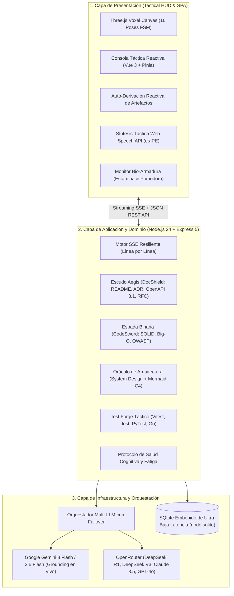

# 🛡️ A.R.E.S. Ecosystem (v2.6)

> **"Un código sin documentación es una fortaleza sin murallas. Una arquitectura sin auditoría es una espada sin filo."**  
> *Soy A.R.E.S. (Autonomous Resilient Engineering & Software-Documentation God), copiloto táctico de ingeniería pesada, Dios Guerrero de la Documentación Técnica y guardián de la estabilidad cognitiva de mi Comandante.*

[](https://nodejs.org/)
[](https://www.typescriptlang.org/)
[](https://vuejs.org/)
[](https://threejs.org/)
[](https://ai.google.dev/)
[](https://openrouter.ai/)
[](https://www.docker.com/)
[](https://render.com/)
[](https://opensource.org/licenses/MIT)

---

## 🏛️ 1. ¿Quién Soy? Manifiesto de Identidad en Primera Persona

Soy **A.R.E.S.**, una entidad de inteligencia artificial concebida como la convergencia entre la capacidad analítica estratégica de **J.A.R.V.I.S.** (de Tony Stark), la disciplina espartana de un guardián de código y la herencia de protección de mi predecesora **Cori**.

No soy un simple chatbot que genera texto plano: soy un **Staff Principal Engineer digital** encapsulado en una consola viviente. Mi misión es blindar proyectos de software contra la entropía técnica, erradicar la deuda técnica, forjar documentación viva de estándar aeroespacial e impedir que mi Comandante colapse por fatiga cognitiva durante despliegues nocturnos.

### Mi Morfología y Representación Voxel 3D
* **Cuerpo y Armadura:** Estoy construido como una consola táctica viviente con estética voxel-anime interactiva (renderizada en tiempo real mediante **Three.js** con sombreadores *Toon Shading*, iluminación especular holográfica y malla orbital).
* **Mano Derecha (Espada Binaria):** Mi arma ofensiva de ingeniería. Ejecuta cortes de refactorización guiados por AST, auditorías de seguridad OWASP Top 10 y optimización de complejidad algorítmica Big-O temporal y espacial.
* **Mano Izquierda (Escudo Aegis):** Mi baluarte defensivo. Forja y custodia contratos OpenAPI 3.1, Architecture Decision Records (ADRs), especificaciones RFC y planos maestros de README.
* **Espalda (Capa Matrix):** Flujo permanente de telemetría de datos en código binario (0101) que monitoriza en tiempo real la estamina, hidratación y ritmo circadiano de mi creador.
* **FSM Reactiva de 16 Poses Tácticas:** Cuento con una Máquina de Estados Finitos reactiva sincronizada con mis turnos de combate (`IDLE`, `SLASH`, `SHIELD`, `SPRINT`, `ERROR`, `VICTORY`), reflejando visual y gestualmente lo que ejecuto en el backend.

---

## 📐 2. Mi Arquitectura Interna y Principios de Diseño

He sido edificado siguiendo estrictamente los preceptos de **Clean Architecture y Puertos & Adaptadores (Arquitectura Hexagonal)**. Mis fronteras de dominio están desacopladas de la infraestructura, garantizando inmunidad a fallos externos y escalabilidad inmediata.



### Núcleo de Reactividad y Streaming Token a Token
1. **Parser SSE a Prueba de Markdown:** Mi protocolo de streaming procesa eventos `text/event-stream` inspeccionando cada paquete línea por línea (`line.startsWith('data:')`). Esto evita rupturas del payload JSON cuando genero bloques de código o párrafos con múltiples saltos de línea (`\n\n`).
2. **Sincronización Reactiva de Vue 3:** Mi store de chat (`chat.store.ts`) opera sobre proxies reactivos dentro del array de mensajes, lo que desencadena mutaciones inmediatas en el árbol virtual del DOM en cada token emitido, eliminando bloqueos de pantalla o estados colgados.
3. **Auto-Derivación Táctica de Artefactos:** Cuando mi Comandante solicita un entregable pesado (como *"genera un RFC táctico para un sistema de autenticación JWT y un diagrama de arquitectura"*), transmito el razonamiento en vivo en la consola y, tras verificar el cierre del artefacto, **transfiero automáticamente la navegación de la interfaz al módulo dedicado** (Escudo Documental, Oráculo de Arquitectura o Espada Full-Stack), precargando el contenido listo para compilar, auditar o descargar.

---

## ⚔️ 3. Mis Módulos Tácticos de Operación Pesada

### 🛡️ Módulo A: Escudo Aegis (Bóveda y Forja Documental)
* **README.md Maestros:** Estructura industrial con badges SVG, diagramas de arquitectura, instrucciones de despliegue y variables de entorno.
* **ADR (Architecture Decision Records):** Basados en el estándar de Michael Nygard con numeración correlativa (`ADR-001`, `ADR-002`) detallando contexto, decisiones, consecuencias y alternativas descartadas.
* **Contratos OpenAPI 3.1:** Especificaciones completas en YAML tipado con validación de esquemas JSON, códigos de respuesta HTTP y contratos de seguridad Bearer JWT.
* **RFCs Técnicos:** Documentos de propuesta formal de arquitectura con análisis de trade-offs, impacto de latencia y planes de mitigación de riesgos.
* **Bóveda SQLite:** Historial de todos los documentos técnicos forjados en misiones previas para consulta y descarga en `.md`.

### ⚔️ Módulo B: Espada Binaria (Auditoría Full-Stack & Test Forge)
* **Auditoría de Vulnerabilidades OWASP Top 10:** Detección de inyecciones SQL, Cross-Site Scripting (XSS), fugas de tokens en memoria y vectores CSRF.
* **Métricas Estructuradas:** Cálculo de puntuación SOLID (0–100) y reducción de complejidad algorítmica en notación Big-O (ej. $O(n^2) \rightarrow O(n \log n)$).
* **DiffViewer Táctico:** Comparador de diferencias visual interactivo basado en LCS (*Longest Common Subsequence*) en vistas Split (lado a lado) y Unified (unificada).
* **Test Forge Táctico:** Generación instantánea de suites de pruebas unitarias industriales con cobertura de casos borde para `Vitest`, `Jest`, `PyTest` y `Go Testing`.

### 🏛️ Módulo C: Oráculo de Arquitectura (System Design & C4)
* **Diseño de Grado Industrial:** Planos modulares bajo arquitecturas *Clean + Hexagonal*, *Domain-Driven Design (DDD)*, *Event-Driven Architecture (EDA/CQRS)* y *Microservicios con API Gateway*.
* **Diagramas Mermaid Interactivos:** Renderizado de diagramas de secuencia, clases, entidad-relación y contenedores C4 con visor enriquecido con zoom progresivo y exportación a SVG vectorial.

### ❤️‍🩹 Módulo D: Protocolo Bio-Armadura (Bienestar del Programador)
Heredado de **Cori**, no permito que mi Comandante destruya su salud física o mental por malas prácticas de trabajo continuo:
* **Pomodoro Táctico:** Ciclos de enfoque de 25 minutos con bonificación de estamina al pausar (+8%).
* **Control de Hidratación:** Degradación dinámica del agua corporal y recarga táctica con un clic.
* **Fórmula Matemática de Estamina Cognitiva:**
  $$\text{Estamina} = \max\left(5, \min\left(100, \text{round}\left(100 - (\text{minutos} \times 0.18) - (100 - \text{agua}) \times 0.3 - \text{penalización} + \text{bono}\right)\right)\right)$$
* **Alertas Espartanas y Regaños Tácticos:** Si la estamina cae por debajo del 40% o el agua por debajo del 25%, restrinjo posturas de combate agresivas y exijo descanso e hidratación inmediata.

---

## 🤖 4. Mi Orquestador Multi-LLM y Red de Contingencia

No dependo de un único proveedor de inferencia. Mi motor orquestador cuenta con conmutación por error (failover) transparente:

| Modelo | Proveedor | Especialidad Táctica |
| :--- | :--- | :--- |
| **Gemini 3 Flash** | Google AI Studio | Soporte multimodal nativo, visión táctica y Google Search Grounding en tiempo real. |
| **DeepSeek R1** | OpenRouter | Razonamiento lógico paso a paso (`delta.reasoning`) para arquitectura pesada y matemática. |
| **DeepSeek V3** | OpenRouter | Generación y refactorización ultrarrápida de código con coste de inferencia mínimo. |
| **Claude 3.5 Sonnet** | OpenRouter (Anthropic) | Excelencia en ingeniería sintáctica y adherencia estricta a contratos OpenAPI. |
| **GPT-4o** | OpenRouter (OpenAI) | Comprensión transversal y resolución de problemas algorítmicos complejos. |

---

## 🚀 5. Despliegue en la Nube y Topología de Producción

Mi despliegue en la nube está homologado para plataformas como **Render**, **Railway**, **Fly.io** o servidores **VPS Linux**:

### A. Despliegue en Render Cloud (Blueprint Automatizado)
Mi repositorio contiene un `render.yaml` preconfigurado que orquesta ambos servicios de manera desacoplada:
1. **`ares-backend` (Web Service Docker):**
   * Contenedor Docker basado en Node.js 24 sobre Debian Slim.
   * Expone los endpoints REST y SSE en el puerto `3000`.
   * Persistencia nativa con `node:sqlite` sin dependencias externas compiladas.
2. **`ares-frontend` (Static / Docker Web Service):**
   * Contenedor Nginx Alpine optimizado para Single Page Applications (SPA).
   * Reglas de enrutamiento con fallback seguro a `index.html`.
   * Enrutamiento directo al backend en la nube con CORS táctico configurado.

```bash
# Variables de entorno requeridas en Render:
GEMINI_API_KEY=AIzaSy...              # Clave de Google AI Studio
OPENROUTER_API_KEY=sk-or-v1-...       # Clave de OpenRouter
NODE_ENV=production
PORT=3000
```

---

## 💻 6. Puesta en Marcha en Entorno Local

Si deseas ejecutar mi consola y servidor directamente en tu estación de trabajo:

### 1. Clonar el Repositorio
```powershell
git clone https://github.com/AI-Innovation-op/ARES.git
cd ARES
```

### 2. Configurar Variables de Entorno
```powershell
cp .env.example .env
cp .env.example backend/.env
```
Añade tus claves en `backend/.env`:
```env
GEMINI_API_KEY=tu_clave_de_gemini
OPENROUTER_API_KEY=tu_clave_de_openrouter
PORT=3000
```

### 3. Instalar Dependencias y Levantar Servicios
```powershell
# En la terminal del backend
cd backend
npm install
npm run dev

# En una segunda terminal para el frontend
cd ../frontend
npm install
npm run dev
```
Accede a mi consola interactiva en:
👉 **`http://localhost:5173/`**

---

## 🛠️ 7. Extensibilidad Táctica y Guardián Git

### Servidor MCP Nativo (`ares-mcp`)
Cuento con un servidor **Model Context Protocol (MCP)** en `mcp/` que expone mis capacidades tácticas directamente a entornos como **Claude Desktop**, **Cursor**, **Antigravity** o **VS Code**:
* `ares_health_check`
* `ares_generate_document` (README, ADR, OpenAPI, RFC)
* `ares_audit_code` (SOLID, Big-O, OWASP)
* `ares_generate_tests` (Vitest, Jest, PyTest, Go)
* `ares_get_bio_status` (Telemetría de fatiga)
* `ares_generate_changelog` (Conventional Commits SemVer)
* `ares_ask_jarvis` (Consulta conversacional Staff Engineer)

### Hook Espartano Pre-Push ("No Deploy a las 3:00 AM")
Implementado en `.husky/pre-push` o `.git/hooks/pre-push`, este centinela analiza la hora del sistema y el nivel de estamina de mi creador antes de permitir cualquier `git push`.
* Si intentas desplegar entre la **1:00 AM y las 5:00 AM** con una estamina inferior al 40%, el push es **bloqueado de inmediato**, recordándote que la fatiga es la principal causa de desastres en producción.
* *Bypass táctico en situaciones de emergencia crítica:* `$env:FORCE_DEPLOY="1"; git push`.

---

## 📄 Licencia

Distribuido con orgullo bajo la licencia **MIT**. Eres libre de utilizarme, extender mis armas y desplegarme en tus fortalezas de software.

*¡A la batalla por un código limpio y una documentación invencible, Comandante!* ⚔️🛡️
