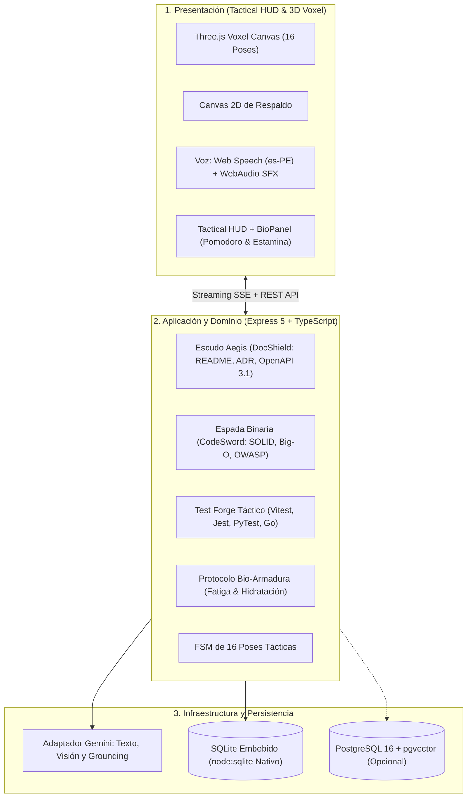

# 🛡️ A.R.E.S. Ecosystem (v2.6 J.A.R.V.I.S. Core)

> **Autonomous Resilient Engineering & Software-Documentation God**  
> Copiloto Full-Stack, Dios Guerrero de la Documentación Técnica y Guardián del Bienestar del Programador (Herencia de Cori).

[](https://nodejs.org/)
[](https://www.typescriptlang.org/)
[](https://vuejs.org/)
[](https://threejs.org/)
[](https://ai.google.dev/)
[](https://www.docker.com/)
[](https://opensource.org/licenses/MIT)

---

## 🏛️ Arquitectura del Sistema

A.R.E.S. implementa una arquitectura desacoplada bajo los principios de **Clean Architecture y Puertos & Adaptadores (Hexagonal)**:



---

## ⚔️ Capacidades Principales

### 1. Experiencia Visual, Voz y UX Táctica
* **Avatar 3D Voxel interactivo:** Renderizado con Three.js (r128), sombreado anime (*toon shading*), rejilla holográfica y rotación por arrastre de ratón.
* **FSM de 16 Poses y 6 Posturas:** Máquina de estados finita (`IDLE`, `SLASH`, `SHIELD`, `SPRINT`, `ERROR`, `VICTORY`) con sincronización reactiva en tiempo real.
* **Voz Táctica con Limpieza Inteligente:** Síntesis mediante Web Speech API (`es-PE`) filtrando bloques Markdown, emojis y códigos técnicos para una dicción natural.
* **Efectos de Sonido Procedurales:** Generados dinámicamente mediante WebAudio API sin descargas de archivos externos.
* **Streaming SSE:** Generación token a token en tiempo real con detección dinámica de poses inline.

### 2. Módulos de Ingeniería Pesada
* **Escudo Aegis (`DocShield`):** Forja documentación industrial de alta fidelidad:
  * `README.md` maestro con badges y diagramas.
  * `ADRs` según el formato Michael Nygard con numeración correlativa (`ADR-001`, `ADR-002`).
  * Contratos `OpenAPI 3.1` completos en YAML.
  * `RFCs` técnicos y diagramas `Mermaid C4`.
* **Visor Interactivo Mermaid:** Renderizado gráfico en vivo con zoom interactivo (`+`, `-`, `Reset`), toggle de código fuente y exportación a `.svg`.
* **Espada Binaria (`CodeSword`):** Auditoría de vulnerabilidades OWASP, refactorización Clean Code y métricas estructuradas:
  * Complejidad Big-O antes y después.
  * Puntuación SOLID (0–100).
  * Blindaje de seguridad.
* **Visor de Diferencias (DiffViewer):** Algoritmo LCS con soporte para modo Split (lado a lado) y Unified (unificado) con estadísticas de adición/eliminación.
* **Test Forge Táctico:** Generador de suites de pruebas unitarias industriales con soporte para `Vitest`, `Jest`, `PyTest` y `Go Testing`.

### 3. Protocolo Bio-Armadura (Bienestar del Programador)
* **Pomodoro Táctico:** Temporizador de 25 minutos con bonificación de descanso (+8%).
* **Control de Hidratación:** Desgaste dinámico de agua y botón de hidratación táctica (`+Hidratar`).
* **Fórmula Matemática de Estamina:**
  $$\text{Estamina} = \max\left(5, \min\left(100, \text{round}\left(100 - (\text{minutos} \times 0.18) - (100 - \text{agua}) \times 0.3 - \text{penalización} + \text{bono}\right)\right)\right)$$
* **Alertas Espartanas:** Regaños tácticos si la estamina cae por debajo del 40% o el agua por debajo del 25%.

### 4. Persistencia y Memoria Total
* **Motor SQLite Embebido:** Utiliza el módulo nativo `node:sqlite` de Node.js 24 sin necesidad de compiladores locales o librerías C++.
* **Memoria de Misiones:** Historial de conversaciones conservado y seleccionable desde la consola.
* **Bóveda Documental y Registro de Combate:** Consulta histórica de documentos técnicos forjados y auditorías previas.
* **Restauración de Telemetría:** Conserva el tiempo de sesión y nivel de hidratación entre recargas.

---

## 🚀 Puesta en Marcha Rápida

### Opción A: Ejecución Local Nativa (Recomendada para Desarrollo)

#### 1. Requisitos Previos
* **Node.js**: v24+ (o v22+ con flags experimentales de SQLite).
* **Clave de API de Gemini**: Obtén tu clave en [Google AI Studio](https://aistudio.google.com/app/apikey).

#### 2. Configuración de Entorno
Copia el archivo de plantilla a la raíz y al backend:
```powershell
cp .env.example .env
cp .env.example backend/.env
```
Edita `backend/.env` y añade tu clave:
```env
GEMINI_API_KEY=tu_clave_real_aqui
```

#### 3. Instalar Dependencias
```powershell
# En la carpeta backend
cd backend
npm install

# En la carpeta frontend
cd ../frontend
npm install
```

#### 4. Iniciar Servidores
En dos terminales separadas:
```powershell
# Terminal 1: Backend API (Puerto 3000)
cd backend
npm run dev

# Terminal 2: Frontend Consola (Puerto 5173)
cd frontend
npm run dev
```
Accede a la consola táctica en tu navegador:
👉 **`http://localhost:5173/`**

---

### Opción B: Despliegue con Docker Compose (1 Solo Comando)

Si cuentas con Docker y Docker Desktop instalados:

```bash
# 1. Copiar y configurar .env con tu GEMINI_API_KEY
cp .env.example .env

# 2. Levantar el ecosistema completo
docker compose up --build -d
```

* **Frontend Consola:** `http://localhost:5173` o `http://localhost:80`
* **Backend API Health:** `http://localhost:3000/health`
* **Persistencia:** La base de datos se almacena en el volumen local `./database/ares.db`.

---

### Opción C: Uso desde la Terminal (A.R.E.S. CLI Táctico)

Puedes interactuar con A.R.E.S. directamente desde cualquier terminal de Windows, Linux o Mac:

```powershell
# 1. Instalar y enlazar el CLI localmente
cd cli
npm install
npm run build
npm link

# 2. Comandos disponibles
ares health                            # Verifica estado del backend y enlace activo
ares bio                               # Telemetría en tiempo real: Estamina, hidratación y fatiga
ares models                            # Lista modelos soportados (Gemini, DeepSeek, Claude, GPT-4o)
ares ask "Orden táctica"               # Consulta directa a la IA desde la terminal
ares audit ./src/archivo.ts            # Audita SOLID, Big-O y OWASP con informe táctico
ares doc adr "Decisión técnica"        # Forja un Architecture Decision Record
ares test ./src/controlador.ts         # Genera suite de pruebas unitarias con Test Forge
```

---

| Método | Endpoint | Descripción |
| :--- | :--- | :--- |
| `GET` | `/health` | Estado del servidor y tiempo de actividad. |
| `POST` | `/api/chat` | Chat táctico multimodal con Gemini. |
| `POST` | `/api/chat/stream` | Streaming de chat token por token vía Server-Sent Events (SSE). |
| `GET` | `/api/conversations` | Lista de misiones/sesiones guardadas en SQLite. |
| `POST` | `/api/conversations` | Crea una nueva misión táctica. |
| `GET` | `/api/conversations/:id/messages` | Historial de mensajes de una conversación. |
| `POST` | `/api/documents/generate` | Forja de documentos con el Escudo Aegis (README, ADR, OpenAPI, RFC). |
| `GET` | `/api/documents/:repositoryId` | Documentos almacenados en la Bóveda Aegis. |
| `POST` | `/api/audit` | Auditoría de código, refactorización y métricas Big-O/SOLID. |
| `GET` | `/api/audit/:repositoryId` | Historial de auditorías registradas en la Espada Binaria. |
| `POST` | `/api/tests/generate` | Generación de suites de pruebas con el Test Forge. |
| `GET` | `/api/tools` | Catálogo de herramientas para Function Calling. |
| `POST` | `/api/tools/execute` | Ejecución programática de herramientas. |
| `GET` | `/api/bio/:commanderId` | Evaluación y persistencia de telemetría biométrica. |
| `GET` | `/api/bio/:commanderId/latest` | Último registro de telemetría del comandante. |

---

## 🛡️ Licencia y Créditos

Distribuido bajo la licencia **MIT**. Consulta el archivo `LICENSE` para más información.  
*Inspirado en la visión táctica de J.A.R.V.I.S., el rigor de la ingeniería de software Clean y la herencia del protocolo de bienestar Cori.*
